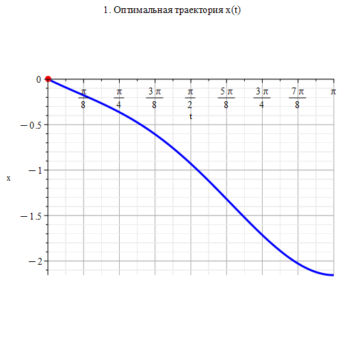
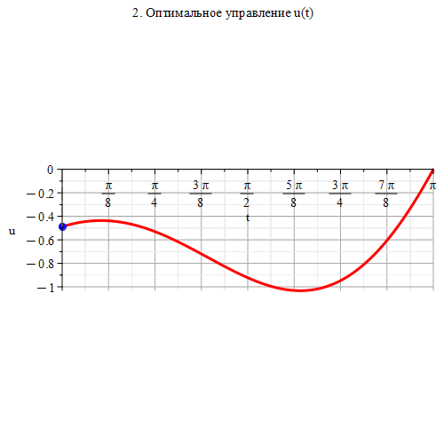
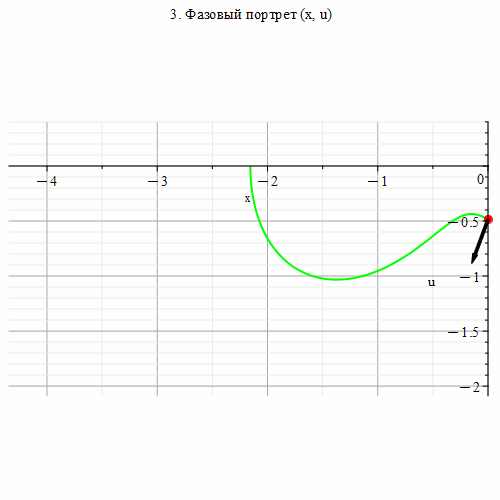
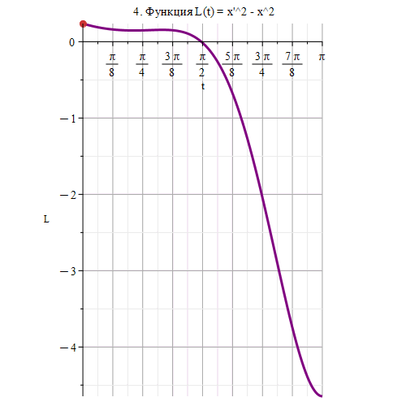

# Задача 10 (Часть 2) — Вариант 17

**Постановка задачи:**
Найти экстремум функционала:

$$
J(x) = \int_0^\pi (\dot{x}^2 - x^2)\, dt \to \text{extr}
$$

при условиях:

$$
x(0) = 0, \qquad \int_0^\pi x \cos t \, dt = \frac{\pi}{2}, \qquad \int_0^\pi x \sin t \, dt = -2
$$

## 📄 Документы

*   **[📥 Скачать PDF с подробным решением](./Project/Задача_10_вариант_17_часть_2.pdf)**
*   **[📝 Скачать исходный код LaTeX](./Codes/Задача_10_вариант_17_часть_2.tex)**
*   **[💻 Скачать рабочий файл Maple (.mw)](./Codes/Задача_10_вариант_17_часть_2.mw)** *(откроется в программе)*
*   **[📄 Посмотреть код Maple (.mpl) прямо на сайте](./Codes/Задача_10_вариант_17_часть_2.mpl)** *(текстовая версия)*
*   **[📓 Открыть Jupyter Notebook с решением](./Project/Задача_10_вариант_17_часть_2.ipynb)**


---

## 📊 Визуализация (Maple)

Ниже представлены анимации, построенные в Maple, демонстрирующие поведение системы.

### 1. Оптимальная траектория $x(t)$
Движение точки по найденной оптимальной траектории. В точке $t=0$ график начинается с нуля, а в $t=\pi$ выходит на горизонталь (условие трансверсальности $\dot{x}(\pi)=0$).

<p align="left">
  
</p>

### 2. Оптимальное управление $u(t)$
Управление начинается в отрицательной области и приходит ровно в ноль при $t=\pi$.

<p align="left">
  
</p>

### 3. Фазовый портрет $(x, u)$
Черная стрелка отображает вектор скорости в каждый момент времени.

<p align="left">
  
</p>

### 4. Подынтегральная функция $L(t)$
Накопление площади (интеграла), которое в итоге дает минимальное значение $J_{min} \approx -3.23$.

<p align="left">
  
</p>

---

## 💻 Исходный код

<details>
<summary><b>Нажмите, чтобы развернуть код Maple (генерация графиков)</b></summary>

```maple
restart;
with(plots):

# Определение оптимальных функций
x_opt := t -> (2/(Pi*(3+Pi^2))) * ( -2*(2+Pi^2)*sin(t) + t*( (4+Pi^2)*cos(t) + Pi*sin(t) ) );
u_opt := t -> (2/(Pi*(3+Pi^2))) * ( -Pi^2*cos(t) + Pi*sin(t) + t*( Pi*cos(t) - (4+Pi^2)*sin(t) ) );
u_prime := t -> -x_opt(t) + (4/(Pi^2+3))*cos(t) - (4*(Pi^2+4)/(Pi*(Pi^2+3)))*sin(t);

# 1. Траектория
p1 := plot(x_opt(t), t = 0..Pi, color = blue, thickness = 3, gridlines):
frames1 := seq(display([p1, pointplot([[t, x_opt(t)]], symbol = solidcircle, symbolsize = 12, color = red)]), t = 0..evalf(Pi), 0.05):
anim1 := display(frames1, insequence = true, scaling = constrained):

# 2. Управление
p2 := plot(u_opt(t), t = 0..Pi, color = red, thickness = 3, gridlines):
frames2 := seq(display([p2, pointplot([[t, u_opt(t)]], symbol = solidcircle, symbolsize = 12, color = blue)]), t = 0..evalf(Pi), 0.05):
anim2 := display(frames2, insequence = true, scaling = constrained):

# 3. Фазовый портрет
p3 := plot([x_opt(t), u_opt(t), t = 0..Pi], color = green, thickness = 2, gridlines):
frames3 := seq(display([p3, pointplot([[x_opt(t), u_opt(t)]], symbol = solidcircle, symbolsize = 12, color = red), plots:-arrow([x_opt(t), u_opt(t)], [x_opt(t) + 0.3*u_opt(t), u_opt(t) + 0.3*u_prime(t)], color = black, thickness = 2)]), t = 0..evalf(Pi), 0.05):
anim3 := display(frames3, insequence = true, scaling = constrained):

# 4. Накопление площади
L_func := t -> u_opt(t)^2 - x_opt(t)^2:
p4 := plot(L_func(t), t = 0..Pi, color = purple, thickness = 3, gridlines):
frames4 := seq(display([p4, plot(L_func(s), s = 0..t, filled = true, color = yellow, transparency = 0.5), pointplot([[t, L_func(t)]], symbol = solidcircle, symbolsize = 12, color = orange)]), t = 0..evalf(Pi), 0.05):
anim4 := display(frames4, insequence = true, scaling = constrained):
