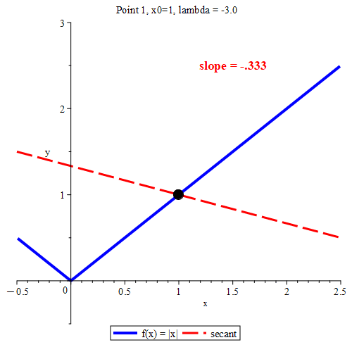
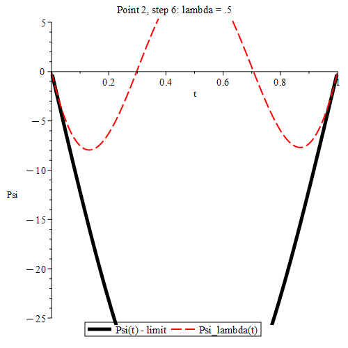
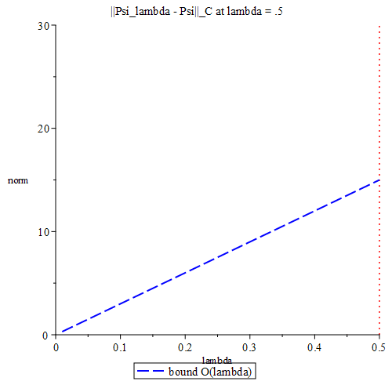
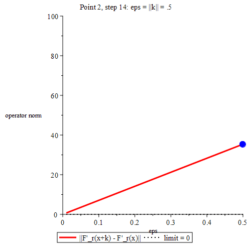

# Задача 2 — Вариант 17

**Постановка задачи:**
Исследовать отображение $F$ на дифференцируемость по Фреше в точке $z$ и в случае дифференцируемости найти производную по Фреше.

**Задание:**
1. $F(x, y) = (xy, x^2 + y^2, |x|)$, $z = (x, y)$, $h = (h_1, h_2)$
2. $(Fx)(t) = (\ddot{x}^2(t) - \cos x(t))^2$, $C^2[0,1] \to C[0,1]$

Алгоритм исследования:
1. Вариация по Лагранжу: $\delta F(x, h) = \lim_{\lambda \to 0} \frac{F(x + \lambda h) - F(x)}{\lambda}$
2. Линейность и ограниченность по $h \Rightarrow F'_\Gamma(x)h = \delta F(x, h)$
3. $x \mapsto F'_\Gamma(x)$ непрерывно (по операторной норме) $\Rightarrow F$ дифференцируемо по Фреше и $F'(x) = F'_\Gamma(x)$

## 📄 Документы

*   **[📥 Скачать PDF с подробным решением](./Project/Задача_2_вариант_17.pdf)**
*   **[📝 Скачать исходный код LaTeX](./Codes/Задача_2_вариант_17.tex)**
*   **[💻 Скачать рабочий файл Maple (.mw)](./Codes/Задача_2_вариант_17.mw)** *(откроется в программе)*
*   **[📄 Посмотреть код Maple (.mpl) прямо на сайте](./Codes/Задача_2_вариант_17.mpl)** *(текстовая версия)*

---

## 📊 Визуализация (Maple)

Ниже представлены анимации, построенные в Maple, демонстрирующие ключевые шаги решения задачи на дифференцируемость по Фреше.

### 1. Сходимость секущей к касательной ($x_0 = 1$)
Поведение разностного отношения для функции $f(x) = |x|$ в точке $x_0 = 1$. Красная пунктирная линия — секущая при различных значениях $\lambda$. При $\lambda \to 0$ наклон секущей стремится к $\text{sgn}(1) = 1$, что подтверждает существование предела и дифференцируемость функции в точке $x_0 \neq 0$.

  

### 2. Излом секущей в точке $x_0 = 0$
Поведение секущей для функции $f(x) = |x|$ в точке $x_0 = 0$. При $\lambda > 0$ наклон равен $+1$, при $\lambda < 0$ наклон равен $-1$. Секущая «ломается» при прохождении через $\lambda = 0$, что наглядно демонстрирует отсутствие единого предела и недифференцируемость функции в точке $x_0 = 0$.

  

### 3. Сравнение разностных отношений
Сравнение функции $\varphi(\lambda) = \frac{|x_0 + \lambda| - |x_0|}{\lambda}$ для двух случаев. Красная линия ($x_0 = 0$): $\varphi(\lambda) = \text{sgn}(\lambda)$ — разрывная функция с разрывом первого рода в нуле. Зелёная линия ($x_0 = 1$): $\varphi(\lambda) \equiv 1$ — константа. Рисунок доказывает, что при $x_0 = 0$ предел не существует, а при $x_0 \neq 0$ предел существует.

  

### 4. Непрерывность $\text{sgn}(x)$ при $x \neq 0$
Непрерывность функции $\text{sgn}(x)$ (элемент матрицы Якоби в позиции $(3,1)$) при $x \neq 0$. Синяя точка показывает текущее значение $x$. Функция постоянна на интервалах $x > 0$ и $x < 0$, что гарантирует непрерывность производной Гато по операторной норме и выполнение условия (3) теоремы.

  

### 5. Сходимость $\Psi_\lambda(t) \to \Psi(t)$
Сходимость $\Psi_\lambda(t)$ к предельной функции $\Psi(t)$ при $\lambda \to 0$. Чёрная сплошная линия — $\Psi(t) = 2\ddot{x}\ddot{h} + h\sin x$ (тестовые функции: $x(t) = t^2$, $h(t) = \sin(\pi t)$). Красная пунктирная линия — $\Psi_\lambda(t)$ при различных значениях $\lambda$. При уменьшении $\lambda$ кривые сливаются, что визуально подтверждает равномерную сходимость $\|\Psi_\lambda - \Psi\|_C \to 0$.

  

### 6. Скорость сходимости $\|\Psi_\lambda - \Psi\|_C$
Скорость сходимости $\|\Psi_\lambda - \Psi\|_C$ при $\lambda \to 0$. Красная точка — вычисленное значение нормы ошибки при текущем $\lambda$. Синяя пунктирная линия — теоретическая граница $O(\lambda) = C|\lambda|$. График показывает линейную зависимость ошибки от $\lambda$, что подтверждает аналитическую оценку.

  

### 7. Сходимость разностного отношения к $\delta F(x,h)$
Сходимость разностного отношения $\frac{F(x+\lambda h) - F(x)}{\lambda}$ к вариации Лагранжа $\delta F(x,h) = 2G\Psi$ при $\lambda \to 0$. Чёрная сплошная линия — предельная функция $\delta F(x,h)$. Красная пунктирная линия — разностное отношение при различных $\lambda$. Равномерная сходимость по $t \in [0,1]$ подтверждает корректность вычисления вариации.

  

### 8. Непрерывность операторной нормы
Непрерывность производной Гато $F'_r(x)$ по операторной норме. Синяя точка — значение нормы $\|F'_r(x+k) - F'_r(x)\|$ при текущем $\varepsilon = \|k\|$. Красная линия — теоретическая оценка $C\|k\|$. Чёрная пунктирная линия — предел $0$. При $\|k\| \to 0$ операторная норма стремится к нулю, что подтверждает выполнение условия (3) и дифференцируемость $F$ по Фреше.

  

