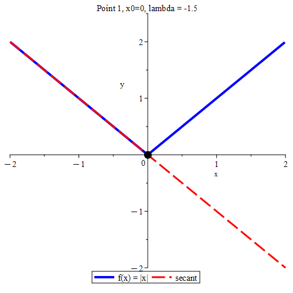
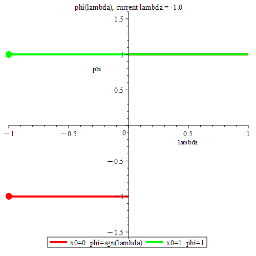
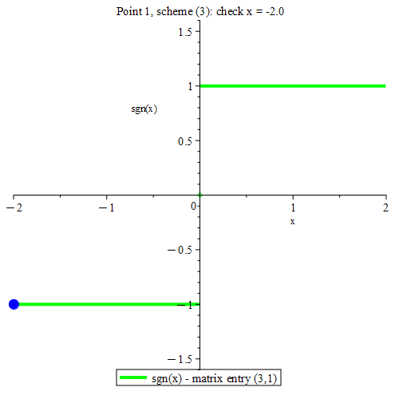
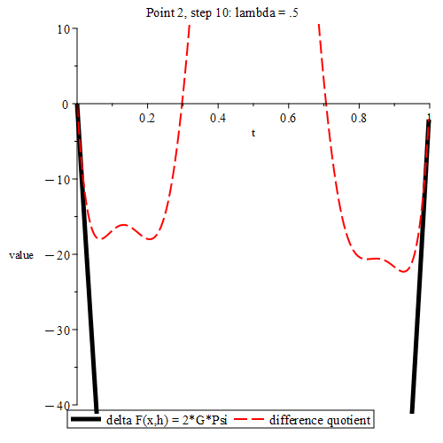

# Задача 2 — Вариант 17

**Постановка задачи:**
Исследовать отображение $F$ на дифференцируемость по Фреше в точке $z$ и в случае дифференцируемости найти производную по Фреше.

**Задание:**
1. $F(x, y) = (xy, x^2 + y^2, |x|)$, $z = (x, y)$, $h = (h_1, h_2)$
2. $(Fx)(t) = (\ddot{x}^2(t) - \cos x(t))^2$, $C^2[0,1] \to C[0,1]$

Алгоритм исследования:
1. Вариация по Лагранжу: $\delta F(x, h) = \lim_{\lambda \to 0} \frac{F(x + \lambda h) - F(x)}{\lambda}$
2. Линейность и ограниченность по $h \Rightarrow F'_{\Gamma}(x)h = \delta F(x, h)$
3. $F'(x) = F'_{\Gamma}(x)$ → $F'(x) = F^{\prime}_{\Gamma}(x)$

## 📄 Документы

*   **[📥 Скачать PDF с подробным решением](./Project/Задача_2_вариант_17.pdf)**
*   **[📝 Скачать исходный код LaTeX](./Codes/Задача_2_вариант_17.tex)**
*   **[💻 Скачать рабочий файл Maple (.mw)](./Codes/Задача_2_вариант_17.mw)** *(откроется в программе)*
*   **[📄 Посмотреть код Maple (.mpl) прямо на сайте](./Codes/Задача_2_вариант_17.mpl)** *(текстовая версия)*

---

## 📊 Визуализация (Maple)

Ниже представлены анимации, построенные в Maple, демонстрирующие ключевые шаги решения задачи на дифференцируемость по Фреше.

### 1. Сходимость секущей к касательной ($x_0 = 1$)
Поведение разностного отношения для функции $f(x) = |x|$ в точке $x_0 = 1$. Красная пунктирная линия — секущая при различных значениях $\lambda$. При $\lambda \to 0$ наклон секущей стремится к $\text{sgn}(1) = 1$, что подтверждает существование предела и дифференцируемость функции в точке $x_0 \neq 0$.

<p align="left">
  
</p>

### 2. Излом секущей в точке $x_0 = 0$
Поведение секущей для функции $f(x) = |x|$ в точке $x_0 = 0$. При $\lambda > 0$ наклон равен $+1$, при $\lambda < 0$ наклон равен $-1$. Секущая «ломается» при прохождении через $\lambda = 0$, что наглядно демонстрирует отсутствие единого предела и недифференцируемость функции в точке $x_0 = 0$.

<p align="left">
  
</p>

### 3. Сравнение разностных отношений
Сравнение функции $\varphi(\lambda) = \frac{|x_0 + \lambda| - |x_0|}{\lambda}$ для двух случаев. Красная линия ($x_0 = 0$): $\varphi(\lambda) = \text{sgn}(\lambda)$ — разрывная функция с разрывом первого рода в нуле. Зелёная линия ($x_0 = 1$): $\varphi(\lambda) \equiv 1$ — константа. Рисунок доказывает, что при $x_0 = 0$ предел не существует, а при $x_0 \neq 0$ предел существует.

<p align="left">
  
</p>

### 4. Непрерывность $\text{sgn}(x)$ при $x \neq 0$
Непрерывность функции $\text{sgn}(x)$ (элемент матрицы Якоби в позиции $(3,1)$) при $x \neq 0$. Синяя точка показывает текущее значение $x$. Функция постоянна на интервалах $x > 0$ и $x < 0$, что гарантирует непрерывность производной Гато по операторной норме и выполнение условия (3) теоремы.

<p align="left">
  
</p>

### 5. Сходимость $\Psi_\lambda(t) \to \Psi(t)$
Сходимость $\Psi_\lambda(t)$ к предельной функции $\Psi(t)$ при $\lambda \to 0$. Чёрная сплошная линия — $\Psi(t) = 2\ddot{x}\ddot{h} + h\sin x$ (тестовые функции: $x(t) = t^2$, $h(t) = \sin(\pi t)$). Красная пунктирная линия — $\Psi_\lambda(t)$ при различных значениях $\lambda$. При уменьшении $\lambda$ кривые сливаются, что визуально подтверждает равномерную сходимость $\|\Psi_\lambda - \Psi\|_C \to 0$.

<p align="left">
  
</p>

### 6. Скорость сходимости $\|\Psi_\lambda - \Psi\|_C$
Скорость сходимости $\|\Psi_\lambda - \Psi\|_C$ при $\lambda \to 0$. Красная точка — вычисленное значение нормы ошибки при текущем $\lambda$. Синяя пунктирная линия — теоретическая граница $O(\lambda) = C|\lambda|$. График показывает линейную зависимость ошибки от $\lambda$, что подтверждает аналитическую оценку.

<p align="left">
  
</p>

### 7. Сходимость разностного отношения к $\delta F(x,h)$
Сходимость разностного отношения $\frac{F(x+\lambda h) - F(x)}{\lambda}$ к вариации Лагранжа $\delta F(x,h) = 2G\Psi$ при $\lambda \to 0$. Чёрная сплошная линия — предельная функция $\delta F(x,h)$. Красная пунктирная линия — разностное отношение при различных $\lambda$. Равномерная сходимость по $t \in [0,1]$ подтверждает корректность вычисления вариации.

<p align="left">
  
</p>

### 8. Непрерывность операторной нормы
Непрерывность производной Гато $F'_r(x)$ по операторной норме. Синяя точка — значение нормы $\|F'_r(x+k) - F'_r(x)\|$ при текущем $\varepsilon = \|k\|$. Красная линия — теоретическая оценка $C\|k\|$. Чёрная пунктирная линия — предел $0$. При $\|k\| \to 0$ операторная норма стремится к нулю, что подтверждает выполнение условия (3) и дифференцируемость $F$ по Фреше.

<p align="left">
  
</p>

---

## 💻 Исходный код

<details>
<summary><b>Нажмите, чтобы развернуть код Maple (генерация 8 анимаций)</b></summary>

```maple
restart;
with(plots):
Digits := 15:

# ============================================================
# ПУНКТ 1: F(x,y) = (x*y, x^2+y^2, |x|)
# ============================================================

f1 := x -> abs(x):

# --- АНИМАЦИЯ 1: сходимость секущих при x0 = 1 ---
frames1 := [seq(
    `if`(abs(lam) < 1e-12,
        display(
            plot(f1(x), x = -0.5 .. 2.5, color = blue, thickness = 4, legend = "f(x) = |x|"),
            plot(1 + 1*(x - 1), x = -0.5 .. 2.5, color = red, linestyle = dash, thickness = 3, legend = "tangent (slope=1)"),
            pointplot([[1, 1]], symbol = solidcircle, symbolsize = 22, color = black),
            textplot([[1.5, 2.5, "slope = 1.000"]], font = [TIMES, BOLD, 14], color = red),
            title = cat("Point 1, x0=1, lambda = ", evalf[3](lam)),
            view = [-0.5 .. 2.5, -0.5 .. 3.0], labels = ["x", "y"]),
        display(
            plot(f1(x), x = -0.5 .. 2.5, color = blue, thickness = 4, legend = "f(x) = |x|"),
            plot(1 + ((abs(1+lam)-1)/lam)*(x - 1), x = -0.5 .. 2.5, color = red, linestyle = dash, thickness = 3, legend = "secant"),
            pointplot([[1, 1]], symbol = solidcircle, symbolsize = 22, color = black),
            textplot([[1.5, 2.5, cat("slope = ", evalf[3]((abs(1+lam)-1)/lam))]], font = [TIMES, BOLD, 14], color = red),
            title = cat("Point 1, x0=1, lambda = ", evalf[3](lam)),
            view = [-0.5 .. 2.5, -0.5 .. 3.0], labels = ["x", "y"])
    ),
    lam in [seq(-3.0 + i*6.0/39, i = 0 .. 39)])]:
display(frames1, insequence = true);


# --- АНИМАЦИЯ 2: излом при x0 = 0 ---
frames2 := [seq(
    `if`(abs(lam) < 1e-12,
        display(
            plot(f1(x), x = -2 .. 2, color = blue, thickness = 4, legend = "f(x) = |x|"),
            plot(0*x, x = -2 .. 2, color = red, linestyle = dash, thickness = 3, legend = "secant"),
            pointplot([[0, 0]], symbol = solidcircle, symbolsize = 18, color = black),
            title = cat("Point 1, x0=0, lambda = ", evalf[3](lam)),
            view = [-2 .. 2, -2.0 .. 2.5], labels = ["x", "y"]),
        display(
            plot(f1(x), x = -2 .. 2, color = blue, thickness = 4, legend = "f(x) = |x|"),
            plot((abs(lam)/lam)*x, x = -2 .. 2, color = red, linestyle = dash, thickness = 3, legend = "secant"),
            pointplot([[0, 0]], symbol = solidcircle, symbolsize = 18, color = black),
            title = cat("Point 1, x0=0, lambda = ", evalf[3](lam)),
            view = [-2 .. 2, -2.0 .. 2.5], labels = ["x", "y"])
    ),
    lam in [seq(-1.5 + i*3.0/39, i = 0 .. 39)])]:
display(frames2, insequence = true);


# --- АНИМАЦИЯ 3: phi(lambda) для x0=0 и x0=1 ---
frames3 := [seq(
    `if`(abs(lam) < 1e-12,
        display(
            plot(abs(t)/t, t = -1 .. 1, discont = true, color = red, thickness = 4, legend = "x0=0: phi=sgn(lambda)"),
            plot(1, t = -1 .. 1, color = green, thickness = 4, legend = "x0=1: phi=1"),
            pointplot([[lam, 0], [lam, 1]], symbol = solidcircle, symbolsize = 18, color = [red, green]),
            title = cat("phi(lambda), current lambda = ", evalf[3](lam)),
            view = [-1 .. 1, -1.6 .. 1.6], labels = ["lambda", "phi"]),
        display(
            plot(abs(t)/t, t = -1 .. 1, discont = true, color = red, thickness = 4, legend = "x0=0: phi=sgn(lambda)"),
            plot(1, t = -1 .. 1, color = green, thickness = 4, legend = "x0=1: phi=1"),
            pointplot([[lam, abs(lam)/lam], [lam, 1]], symbol = solidcircle, symbolsize = 18, color = [red, green]),
            title = cat("phi(lambda), current lambda = ", evalf[3](lam)),
            view = [-1 .. 1, -1.6 .. 1.6], labels = ["lambda", "phi"])
    ),
    lam in [seq(-1.0 + i*2.0/39, i = 0 .. 39)])]:
display(frames3, insequence = true);


# --- АНИМАЦИЯ 4: sgn(x) непрерывна при x <> 0 ---
frames4 := [seq(
    display(
        plot(signum(x), x = -2 .. 2, discont = true, color = green, thickness = 4, legend = "sgn(x) - matrix entry (3,1)"),
        plot([x_test, x_test], -1.6 .. 1.6, color = red, linestyle = dot, thickness = 2),
        pointplot([[x_test, signum(x_test)]], symbol = solidcircle, symbolsize = 20, color = blue),
        title = cat("Point 1, condition (3): check x = ", evalf[3](x_test)),
        view = [-2 .. 2, -1.6 .. 1.6], labels = ["x", "sgn(x)"]),
    x_test in [seq(-2.0 + i*4.0/39, i = 0 .. 39)])]:
display(frames4, insequence = true);


# ============================================================
# ПУНКТ 2: (Fx)(t) = (x''(t)^2 - cos x(t))^2
# ============================================================

xf := t -> t^2:
hf := t -> sin(Pi*t):
xdd := t -> 2:
hdd := t -> -Pi^2*sin(Pi*t):

G_fn := t -> xdd(t)^2 - cos(xf(t)):
Psi_fn := t -> 2*xdd(t)*hdd(t) + hf(t)*sin(xf(t)):

PsiL := (t, lam) -> 2*xdd(t)*hdd(t) + lam*hdd(t)^2 + cos(xf(t))*(1 - cos(lam*hf(t)))/lam + sin(xf(t))*sin(lam*hf(t))/lam:

gL := (t, lam) -> (xdd(t) + lam*hdd(t))^2 - cos(xf(t) + lam*hf(t)):
Fq := (t, lam) -> (gL(t, lam)^2 - G_fn(t)^2)/lam:
dF := t -> 2*G_fn(t)*Psi_fn(t):

# --- АНИМАЦИЯ 5: Psi_lambda(t) -> Psi(t) ---
lams5 := [seq(0.5 - i*0.49/39, i = 0 .. 39)]:
frames5 := [seq(
    display(
        plot(Psi_fn(t), t = 0 .. 1, color = black, thickness = 5, legend = "Psi(t) - limit"),
        plot(PsiL(t, lam), t = 0 .. 1, color = red, linestyle = dash, thickness = 2, legend = "Psi_lambda(t)"),
        title = cat("Point 2, step 6: lambda = ", evalf[3](lam)),
        view = [0 .. 1, -25 .. 5], labels = ["t", "Psi"]),
    lam in lams5)]:
display(frames5, insequence = true);


# --- АНИМАЦИЯ 6: скорость сходимости ||Psi_lambda - Psi||_C ---
tgrid := [seq(0.0 .. 1.0, 0.01)]:
lams6 := [seq(0.5 - i*0.49/39, i = 0 .. 39)]:
err_vals := [seq(max(seq(abs(PsiL(tt, l) - Psi_fn(tt)), tt in tgrid)), l in lams6)]:

frames6 := [seq(
    display(
        pointplot([[lams6[i], err_vals[i]]], symbol = solidcircle, symbolsize = 18, color = red),
        plot([0, lams6[i]], [err_vals[i], err_vals[i]], color = red, thickness = 2),
        plot([lams6[i], lams6[i]], [0, err_vals[i]], color = red, linestyle = dot, thickness = 1),
        plot(30*e, e = 0.01 .. 0.5, color = blue, linestyle = dash, thickness = 2, legend = "bound O(lambda)"),
        title = cat("||Psi_lambda - Psi||_C at lambda = ", evalf[3](lams6[i])),
        view = [0 .. 0.5, 0 .. 30], labels = ["lambda", "norm"]),
    i = 1 .. 40)]:
display(frames6, insequence = true);


# --- АНИМАЦИЯ 7: разностное отношение -> delta F(x,h) ---
lams7 := [seq(0.5 - i*0.49/39, i = 0 .. 39)]:
frames7 := [seq(
    display(
        plot(dF(t), t = 0 .. 1, color = black, thickness = 5, legend = "delta F(x,h) = 2*G*Psi"),
        plot(Fq(t, lam), t = 0 .. 1, color = red, linestyle = dash, thickness = 2, legend = "difference quotient"),
        title = cat("Point 2, step 10: lambda = ", evalf[3](lam)),
        view = [0 .. 1, -40 .. 10], labels = ["t", "value"]),
    lam in lams7)]:
display(frames7, insequence = true);


# --- АНИМАЦИЯ 8: операторная норма -> 0 ---
C_op := evalf(2*(2*max(seq(abs(xdd(t)), t in tgrid)) + 1)^2 + 6*max(seq(abs(G_fn(t)), t in tgrid))):
epss := [seq(0.5 - i*0.49/39, i = 0 .. 39)]:
frames8 := [seq(
    display(
        plot(C_op*e, e = 0.01 .. 0.5, color = red, thickness = 3, legend = "||F'_r(x+k) - F'_r(x)||"),
        plot(0, e = 0.01 .. 0.5, color = black, linestyle = dot, thickness = 2, legend = "limit = 0"),
        pointplot([[eps, C_op*eps]], symbol = solidcircle, symbolsize = 18, color = blue),
        title = cat("Point 2, step 14: eps = ||k|| = ", evalf[3](eps)),
        view = [0 .. 0.5, 0 .. max(100, C_op*eps*1.2)], labels = ["eps", "operator norm"]),
    eps in epss)]:
display(frames8, insequence = true);


printf("\n=== DONE! 8 animations built ===\n");
printf("To save each animation as GIF: right-click -> Export As -> GIF\n");
