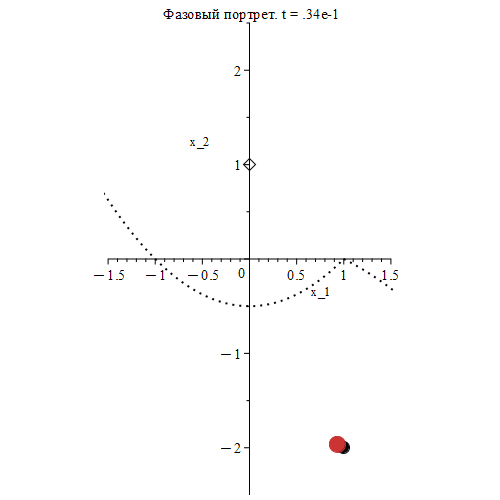
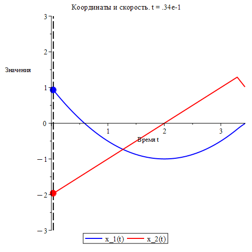
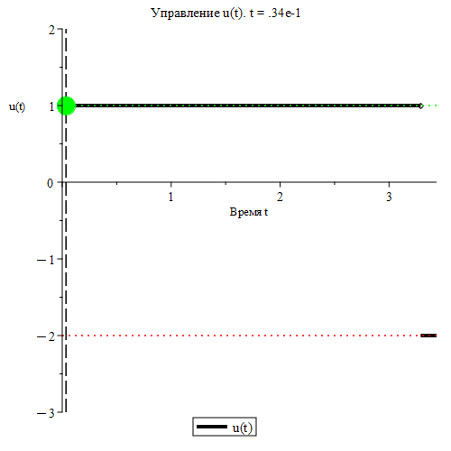

# Задача 17 (Часть 2) — Вариант 17

[](./Задача_17_Часть_2_Вариант_17.pdf)

## 1. Постановка задачи

Найти оптимальное по быстродействию управление для объекта $\ddot{x} = u$:

$$
T \to \inf, \qquad -2 \le u \le 1,
$$

$$
x(0) = 1,\quad \dot{x}(0) = -2,\quad x(T) = 0,\quad \dot{x}(T) = 1.
$$

## 📄 Документы

*   **[📥 Скачать PDF с подробным решением](./Projects/Задача_17_Часть_2_Вариант_17.pdf)**
*   **[📝 Исходный код LaTeX](./Codes/Задача_17_Часть_2_Вариант_17.tex)**
*   **[💻 Рабочий файл Maple (.mw)](./Codes/Задача_17_Часть_2_Вариант_17.mw)**
*   **[📄 Код Maple (.mpl) — текстовая версия](./Codes/Задача_17_Часть_2_Вариант_17.mpl)**
*   **[📓 Jupyter Notebook с решением](./Projects/Задача_17_Часть_2_Вариант_17.ipynb)**

## 2. Краткое решение

**1. Принцип максимума.** В фазовых координатах $(x_1, x_2)$ сопряжённая $p_2(t)$ линейна, поэтому управление релейное с **одним переключением**. Из граничных условий следует структура: сначала разгон ($u=1$), затем торможение ($u=-2$).

**2. Линия переключения Г.** Условие попадания в цель $(0,1)$ задаёт параболы:

$Г: x_1$ = $\begin{cases} -x_2^2/4 + 1/4, & x_2 \ge 1 \\ x_2^2/2 - 1/2, & x_2 \le 1 \end{cases}$

**3. Точка переключения и время.** Пересечение траектории из $(1,-2)$ с Г даёт $x_2(\tau) = \sqrt{5/3}$, $x_1(\tau) = -1/6$.
Отсюда момент переключения $\tau = 2 + \sqrt{5/3}$ и минимальное время $T_{\min} = \frac{3}{2}(1 + \sqrt{5/3}) \approx 3.436$.

## 3. 🎬 Анимации

### Анимация 1. Фазовый портрет
**Файл:** `phase_portrait.gif`



Оранжевая точка катится по фазовой плоскости $(x_1, x_2)$ от старта $(1,-2)$ к финишу $(0,1)$. 

Синий след — разгон ($u=1$), зелёный — торможение ($u=-2$). 

Чёрный пунктир — линия переключения $\Gamma$. Видно, как траектория пересекает $\Gamma$ ровно в момент смены цвета.

---

### Анимация 2. Координата и скорость во времени
**Файл:** `time_plots.gif`



Скорость монотонно растёт до $\tau$, затем монотонно падает до $1$.

Координата в конце строго обращается в ноль — все граничные условия выполнены.

---

### Анимация 3. Релейное управление
**Файл:** `control.gif`



Управление $u(t)$ — ступенька: зелёный шарик бежит по уровню $u=1$, в момент $\tau$ резко падает на уровень $u=-2$ и меняет цвет на красный.
---

## 4. Maple-код

<details>
<summary>Нажмите, чтобы раскрыть полный Maple-код</summary>

```maple
restart;
with(plots):
with(plottools):
Digits := 15;

# ============================================================
# Параметры задачи (числовые значения)
# ============================================================
tau_val := evalf(2 + sqrt(5/3));
T_val   := evalf(1.5*(1 + sqrt(5/3)));
x2_tau  := evalf(sqrt(5/3));
x1_tau  := -1/6;

x1_t := t -> piecewise(t <= tau_val, 1 - 2*t + t^2/2,
                              x1_tau + x2_tau*(t - tau_val) - (t - tau_val)^2):
x2_t := t -> piecewise(t <= tau_val, -2 + t, x2_tau - 2*(t - tau_val)):
u_t  := t -> piecewise(t <= tau_val, 1, -2):

TITLE_FONT := [TIMES, BOLD, 15]:
LABEL_FONT := [TIMES, BOLD, 13]:
TEXT_FONT  := [TIMES, BOLD, 12]:

# ============================================================
# Анимация 1. Фазовый портрет
# ============================================================
phase_portrait := proc(tau)
    local gamma, pt_start, pt_end, blue_traj, green_traj, dot, txt;
    gamma := display(
        plot(-x2^2/4 + 1/4, x2=1..2.5,  color=black, thickness=2, linestyle=dot),
        plot( x2^2/2 - 1/2, x2=-2.5..1, color=black, thickness=2, linestyle=dot));
    pt_start := point([1, -2], color=black, symbol=solidcircle, symbolsize=20):
    pt_end   := point([0,  1], color=black, symbol=diamond,     symbolsize=20):
    blue_traj  := plot([x1_t(t), x2_t(t), t=0..min(tau, tau_val)], color=blue,  thickness=4):
    green_traj := `if`(tau > tau_val,
                       plot([x1_t(t), x2_t(t), t=tau_val..tau], color=green, thickness=4),
                       NULL):
    dot := point([evalf(x1_t(tau)), evalf(x2_t(tau))],
                 color=orange, symbol=solidcircle, symbolsize=25):
    txt := textplot([-0.2, 2.2,
        sprintf("t = %.3f   x1 = %.3f   x2 = %.3f", tau, x1_t(tau), x2_t(tau))],
        font=TEXT_FONT):
    display(gamma, pt_start, pt_end, blue_traj, green_traj, dot, txt,
        title="Фазовый портрет", titlefont=TITLE_FONT,
        labels=["x_1", "x_2"], labelfont=LABEL_FONT,
        view=[-1.5..1.5, -2.5..2.5], scaling=constrained, gridlines=true);
end proc:

# ============================================================
# Анимация 2. Координата и скорость во времени
# ============================================================
time_plots := proc(tau)
    local px1, px2, scan, d1, d2, txt;
    px1  := plot(x1_t(t), t=0..T_val, color=blue,  thickness=3, legend="x_1(t)"):
    px2  := plot(x2_t(t), t=0..T_val, color=red,   thickness=3, legend="x_2(t)"):
    scan := plot([tau, tau], [-3, 3], color=black, linestyle=dash, thickness=2):
    d1   := point([tau, evalf(x1_t(tau))], color=blue, symbol=solidcircle, symbolsize=18):
    d2   := point([tau, evalf(x2_t(tau))], color=red,  symbol=solidcircle, symbolsize=18):
    txt  := textplot([T_val/2, 2.5,
        sprintf("t = %.3f   x_1 = %.3f   x_2 = %.3f", tau, x1_t(tau), x2_t(tau))],
        font=TEXT_FONT):
    display(px1, px2, scan, d1, d2, txt,
        title="Координата и скорость во времени", titlefont=TITLE_FONT,
        labels=["t", "x_1, x_2"], labelfont=LABEL_FONT,
        view=[0..T_val, -3..3], gridlines=true);
end proc:

# ============================================================
# Анимация 3. Релейное управление
# ============================================================
control := proc(tau)
    local pu, lvl1, lvl2, scan, ball, txt;
    pu   := plot(u_t(t), t=0..T_val, color=black, thickness=4, discont=true, legend="u(t)"):
    lvl1 := plot([0, T_val], [ 1,  1], color=green, linestyle=dot, thickness=1):
    lvl2 := plot([0, T_val], [-2, -2], color=red,   linestyle=dot, thickness=1):
    scan := plot([tau, tau], [-3, 2], color=black, linestyle=dash, thickness=1):
    ball := point([tau, `if`(tau <= tau_val, 1, -2)],
                  color=`if`(tau <= tau_val, green, red),
                  symbol=solidcircle, symbolsize=28):
    txt  := textplot([T_val/2, 1.6,
        sprintf("t = %.3f   u = %d   tau = %.3f", tau,
                `if`(tau <= tau_val, 1, -2), tau_val)],
        font=TEXT_FONT):
    display(pu, lvl1, lvl2, scan, ball, txt,
        title="Релейное управление u(t)", titlefont=TITLE_FONT,
        labels=["t", "u(t)"], labelfont=LABEL_FONT,
        view=[0..T_val, -3..2], gridlines=true);
end proc:

# ============================================================
# ЗАПУСК АНИМАЦИЙ
# ============================================================
plots:-animate(phase_portrait, [tau], tau=0..T_val, frames=120, background=white);
plots:-animate(time_plots,     [tau], tau=0..T_val, frames=120, background=white);
plots:-animate(control,        [tau], tau=0..T_val, frames=120, background=white);

# --- Сохранение в GIF (раскомментировать при необходимости) ---
# plot[display](plots:-animate(phase_portrait,[tau],tau=0..T_val,frames=120),
#               filename="D:/phase_portrait.gif");
# plot[display](plots:-animate(time_plots,[tau],tau=0..T_val,frames=120),
#               filename="D:/time_plots.gif");
# plot[display](plots:-animate(control,[tau],tau=0..T_val,frames=120),
#               filename="D:/control.gif");
```

</details>
