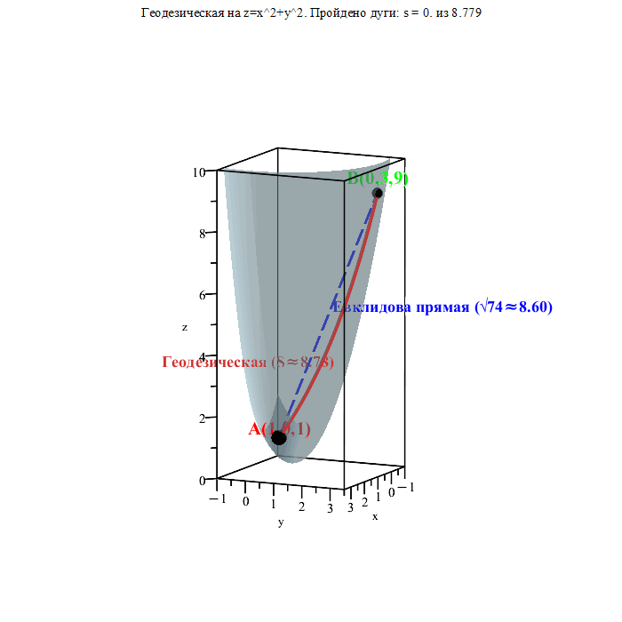

# Задание 23 (Часть 2) — Вариант 17

**Постановка задачи:**
Найти расстояние между точками $A(1,0,1)$ и $B(0,3,9)$ на поверхности:
$$z = x^2 + y^2$$

Необходимо найти длину геодезической (кратчайшего пути по поверхности), соединяющей эти точки, и сравнить её с евклидовым расстоянием.

## 📄 Документы

*   **[📥 Скачать PDF с подробным решением](./Projects/Задание_23_вариант_17_часть_2.pdf)**
*   **[📚 Скачать конспект лекций (Мохов О.И. — Классическая дифференциальная геометрия)](./Projects/differential-geometry-M.pdf)**
*   **[📝 Скачать исходный код LaTeX](./Codes/Задание_23_вариант_17_часть_2.tex)**
*   **[📄 Посмотреть код Maple (.mpl) прямо на сайте](./Codes/Задание_23_вариант_17_часть_2.mpl)** *(текстовая версия)*
*   **[📓 Открыть Jupyter Notebook с решением](./Projects/Задание_23_вариант_17_часть_2.ipynb)**

---

## 📚 Теоретическая справка

При решении задачи рассмотрели следующие теоремы и утверждения из курса дифференциальной геометрии:

### 1. Геодезические и вектор кривизны (§13.1, Утверждение 22)

Кривая на поверхности является геодезической тогда и только тогда, когда вектор её кривизны (ускорения) в натуральной параметризации коллинеарен вектору нормали к поверхности. Это равносильно выполнению уравнения геодезических в натуральной параметризации:

$\Gamma_{ij}^k \dot{u}^i \dot{u}^j$ + $\ddot{u}^k = 0$, $\quad \forall k.$


### 2. Теорема Клеро (Теорема 21, §13.2)

Для любой поверхности вращения вдоль геодезической выполняется равенство (первый интеграл):

$\rho(s) \cos \alpha(s)$ = $\text{const}$,

где:
*   $\rho(s)$ — расстояние от точки пересечения до оси вращения (радиус параллели);
*   $\alpha(s)$ — угол между параллелью и геодезической в этой точке.

В нашей задаче поверхность $z=x^2+y^2$ является поверхностью вращения. В цилиндрических координатах $\rho = r$, а $\cos \alpha = r\dot{\varphi}$. Это напрямую приводит нас к первому интегралу:

$r^2 \dot{\varphi}$ = $c$ = $\text{const}.$


### 3. Уравнения Эйлера-Лагранжа (§13.4)

Геодезические являются экстремалями функционала длины $S[\gamma]$ = $\int L \, dt$. 

Для поиска экстремума используются уравнения Эйлера-Лагранжа:

$\frac{\partial L}{\partial u^i}$ - $\frac{d}{dt} \left( \frac{\partial L}{\partial \dot{u}^i} \right)$ = $0.$


### 4. Экстремальные свойства геодезических (Теорема 23, §13.5)

Чтобы избежать сложностей с квадратным корнем в функционале длины $L$ = $\sqrt{g_{ij}\dot{u}^i\dot{u}^j}$, на практике часто переходят к **функционалу энергии** (квадрату длины):

$\tilde{S}[\gamma]$ = $\int g_{ij} \dot{u}^i \dot{u}^j $\, $dt.$

Экстремали этого функционала совпадают с геодезическими, но параметр $t$ на них должен быть пропорционален натуральному параметру $s$. Если параметр натуральный, то квадрат длины вектора скорости равен единице:

$g_{ij} \dot{u}^i \dot{u}^j = 1.$

Именно это условие мы используем при решении задачи вместе с теоремой Клеро.

---

## 📊 Визуализация (Maple)

Ниже представлена анимация, построенная в Maple, демонстрирующая геодезическую на параболоиде вращения.

### Геодезическая на поверхности $z=x^2+y^2$
Голубая поверхность — параболоид. Красная и зеленая сферы — точки $A$ и $B$. 
*   🔵 **Синяя пунктирная линия** — прямое евклидово расстояние в пространстве $\sqrt{74} \approx 8.602$.
   
*   🟠 **Оранжевая кривая** — геодезическая линия на поверхности $\approx 8.779$, найденная с помощью теоремы Клеро.
   
*   ⚫ **Чёрная точка** — анимированно движется вдоль геодезической из точки $A$ в точку $B$.

<p align="left">
  
</p>

---

## 💻 Исходный код

<details>
<summary><b>Нажмите, чтобы развернуть код Maple (генерация анимации)</b></summary>

```maple
restart;
with(plots):
with(plottools):

# =========================================================
# 1. ВЫЧИСЛЕНИЕ КОНСТАНТЫ КЛЕРО (c)
# =========================================================
eq_c := int(c*sqrt(1+4*r^2)/(r*sqrt(r^2-c^2)), r=1..3) = Pi/2:
c_opt := fsolve(eq_c, c=0..1);

# =========================================================
# 2. ВЫЧИСЛЕНИЕ ДЛИНЫ ГЕОДЕЗИЧЕСКОЙ (S_max)
# =========================================================
S_max := evalf(int(r*sqrt(1+4*r^2)/sqrt(r^2-c_opt^2), r=1..3));
S_euclid := evalf(sqrt(74));

# =========================================================
# 3. РЕШЕНИЕ ОДУ (Натуральная параметризация)
# =========================================================
sys := {
    diff(r(s), s) = sqrt(r(s)^2 - c_opt^2) / (r(s) * sqrt(1 + 4*r(s)^2)),
    diff(phi(s), s) = c_opt / r(s)^2,
    r(0) = 1, 
    phi(0) = 0
}:
sol := dsolve(sys, numeric, [r(s), phi(s)]):

# Функция для получения 3D-координат (x, y, z) точки на геодезической
Geo_pt := proc(s_val) 
    local res, r_val, phi_val;
    res := sol(s_val);
    r_val := eval(r(s), res);
    phi_val := eval(phi(s), res);
    return [r_val*cos(phi_val), r_val*sin(phi_val), r_val^2];
end proc:

# Предвычисление точек для идеально плавной отрисовки линии
N_curve := 200:
s_vals := [seq(i*S_max/N_curve, i=0..N_curve)]:
pts_geo := [seq(Geo_pt(sv), sv in s_vals)]:

# =========================================================
# 4. ПОСТРОЕНИЕ ГЕОМЕТРИЧЕСКИХ ОБЪЕКТОВ
# =========================================================
# Поверхность
Surf := plot3d([r*cos(theta), r*sin(theta), r^2], r=0..3.5, theta=0..2*Pi, 
    style=surface, color="LightBlue", transparency=0.4, grid=[50,50], 
    axes=boxed, labels=["x","y","z"]):

# Геодезическая линия (оранжевая)
Geo := spacecurve(pts_geo, color=orange, thickness=4):

# Евклидова прямая (пунктирная синяя)
Seg := line([1,0,1], [0,3,9], color=blue, thickness=3, linestyle=dash):

# Точки A и B
PtA := sphere([1,0,1], 0.15, color=red):
PtB := sphere([0,3,9], 0.15, color=green):
TextA := textplot3d([1, 0, 1.3, "A(1,0,1)"], color=red, font=[TIMES, BOLD, 16]):
TextB := textplot3d([0, 3, 9.5, "B(0,3,9)"], color=green, font=[TIMES, BOLD, 16]):

# Подписи к линиям
mid_pt := Geo_pt(S_max/2):
Text_Geo := textplot3d([mid_pt[1], mid_pt[2], mid_pt[3]-1.5, "Геодезическая (S≈8.78)"], 
    color=orange, font=[TIMES, BOLD, 14], align={ABOVE, LEFT}):

Text_Seg := textplot3d([0.5, 1.5, 5, "Евклидова прямая (√74≈8.60)"], 
    color=blue, font=[TIMES, BOLD, 14], align={ABOVE, RIGHT}):

# =========================================================
# 5. СОЗДАНИЕ АНИМАЦИИ
# =========================================================
N := 120: # Количество кадров анимации
frames := [seq(
    display(Surf, Seg, Geo, PtA, PtB, TextA, TextB, Text_Geo, Text_Seg,
        # Анимированная черная точка
        pointplot3d(Geo_pt(si), symbol=solidsphere, symbolsize=25, color=black),
        title=cat("Геодезическая на z=x^2+y^2. Пройдено дуги: s = ", evalf[4](si), " из ", evalf[4](S_max)),
        view=[-1..3.5, -1..3.5, 0..10], 
        scaling=constrained, 
        orientation=[50, 70, 10] # Угол обзора
    ),
    si = 0 .. S_max, S_max/(N-1)
)]:

# Воспроизведение анимации
display(frames, insequence = true);
