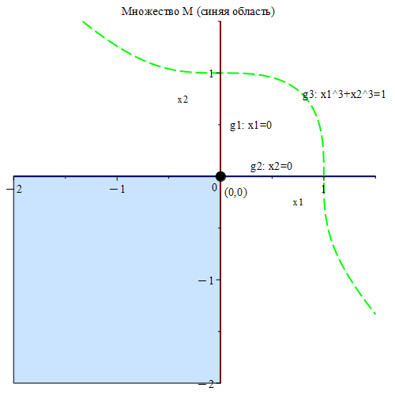
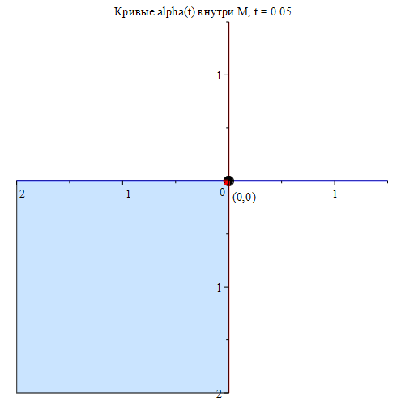
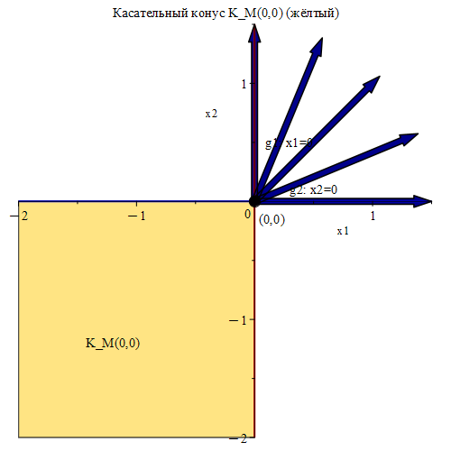
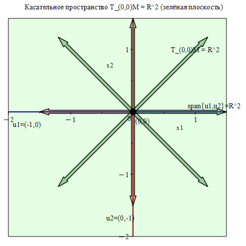
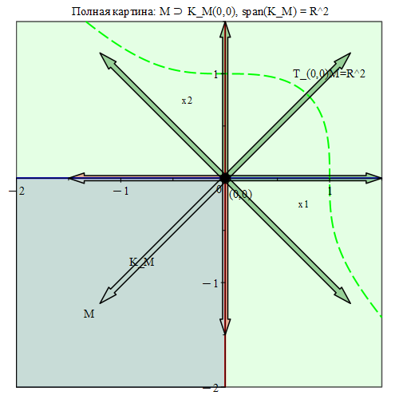
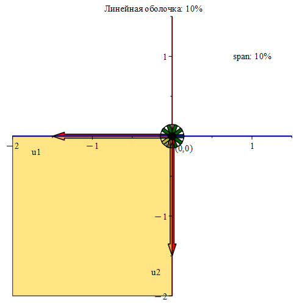

# Задача 3. Касательное пространство к множеству $M$ в точке $(0,0)$

## Постановка задачи

Найти касательное пространство к множеству

$$M = \{(x_1, x_2) \in \mathbb{R}^2 \mid x_1 \le 0,\ x_2 \le 0,\ x_1^3 + x_2^3 \le 1\}$$

в точке $p = (0, 0)$.

---

## 📄 Документы

*   **[📥 Скачать PDF с подробным решением](./Projects/Задача_3_Часть_2_Вариант_17.pdf)**
*   **[📝 Скачать исходный код LaTeX](./Codes/Задача_3_Часть_2_Вариант_17.tex)**
*   **[💻 Скачать рабочий файл Maple (.mw)](./Codes/Задача_3_вариант_17_часть_2.mw)** *(откроется в программе)*
*   **[📄 Посмотреть код Maple (.mpl) прямо на сайте](./Codes/Задача_3_вариант_17_часть_2.mpl)** *(текстовая версия)*
*   **[📓 Jupyter Notebook с решением по блокам](./Projects/Задача_3_Часть_2_Вариант_17.ipynb)** *(теория + символьные вычисления + визуализация)*

---

## 📚 Теоретические основания

### Определения

**Касательный вектор.** Касательным вектором к множеству $M$ в точке $p$ называется **вектор скорости** $\alpha'(0)$ некоторой гладкой кривой $\alpha$, целиком лежащей в $M$ и проходящей через $p$:

$$\alpha: [0, \varepsilon) \to M, \quad \alpha(0) = p.$$

> **Замечание.** Для множеств с границей (как наше $M$) кривая определяется на полуинтервале $[0, \varepsilon)$, так как из граничной точки нельзя двигаться «наружу».

**Касательный конус** $K_M(p)$ — множество всех возможных векторов скорости $\alpha'(0)$ по всем кривым $\alpha: [0, \varepsilon) \to M$ с $\alpha(0) = p$:

$$K_M(p) = \{v \in \mathbb{R}^n \mid \exists\, \alpha: [0,\varepsilon) \to M,\ \alpha(0) = p,\ \alpha'(0) = v\}.$$

**Касательное пространство** к $M$ в точке $p$ — это **линейная оболочка** касательного конуса:

$$T_p M = \text{span}\, K_M(p) = \{\sum_{i=1}^k \lambda_i v_i \mid k \in \mathbb{N},\ \lambda_i \in \mathbb{R},\ v_i \in K_M(p)\}.$$

Это наименьшее линейное подпространство $\mathbb{R}^n$, содержащее все касательные направления.

**Замечание.** Для открытого множества $U \subset \mathbb{R}^n$ касательное пространство $T_p U \cong \mathbb{R}^n$, так как из любой точки можно двигаться в любом направлении. Для множества с границей касательный конус $K_M(p)$ может быть строго меньше $\mathbb{R}^n$, но его линейная оболочка всё равно может дать всё $\mathbb{R}^n$ (как в нашей задаче).

---

## 📊 Визуализация

### Рис. 1. Множество $M$

  

Множество $M$ (синяя область). Точка $(0,0)$ — угол множества. Красная линия — граница $g_1: x_1=0$, синяя — $g_2: x_2=0$, зелёная пунктирная — $g_3: x_1^3+x_2^3=1$ (неактивно в $(0,0)$).

---

### Рис. 2. Кривые $\alpha(t)$ внутри $M$

  

Кривые $\alpha(t) = (tv_1, tv_2)$ внутри $M$ при $t \in [0, \varepsilon)$. Красные стрелки — направления движения из $(0,0)$ внутрь множества.

---

### Рис. 3. Касательный конус $K_M(0,0)$

  

Касательный конус $K_M(0,0)$ (жёлтая область) — третий квадрант. Синие стрелки — векторы скорости $\alpha'(0)$ для кривых из $M$.

---

### Рис. 4. Касательное пространство $T_{(0,0)}M = \mathbb{R}^2$

  

Касательное пространство $T_{(0,0)}M = \mathbb{R}^2$ (зелёная плоскость). Красные стрелки — базис конуса $u_1=(-1,0)$, $u_2=(0,-1)$. Зелёные стрелки — их линейные комбинации (вся плоскость).

---

### Рис. 5. Полная картина

  

Полная картина: $M \supset K_M(0,0)$, $\operatorname{span}(K_M) = \mathbb{R}^2$. Синий — $M$, жёлтый — $K_M$, зелёный — $T_{(0,0)}M$.

---

### Рис. 6. Построение линейной оболочки

  

Динамическое построение линейной оболочки $\operatorname{span}\{u_1, u_2\}$. Из двух векторов конуса (красные) получается вся плоскость $\mathbb{R}^2$ (зелёные стрелки).
