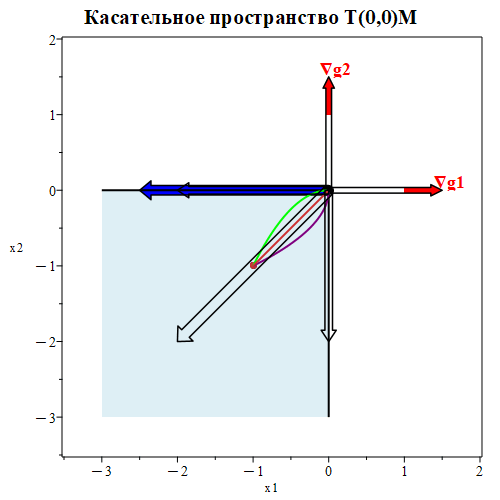

# Задача 3. Касательное пространство к множеству в угловой точке

## Постановка задачи
Найти касательное пространство к множеству 
$\(M = \{(x_1, x_2) \in \mathbb{R}^2 \mid x_1 \le 0,\ x_2 \le 0,\ x_1^3 + x_2^3 \le 1\}$\)
в точке $\(x_0 = (0, 0)\)$.

## Математическое решение (кратко)
1. **Активность ограничений:** В точке $\(0,0)\$ ограничения $\(x_1 \le 0\)$ и $\(x_2 \le 0\)$ активны. Ограничение $\(x_1^3 + x_2^3 \le 1\)$ неактивно (так как $\(0 + 0 < 1\)$.
2. **Градиенты:** $\(\nabla g_1$ = $(1, 0)^T\)$, $\(\nabla g_2 = (0, 1)^T\)$. Условие регулярности выполнено.
3. **Касательный конус:** Задается системой $\(\nabla g_i^T v \le 0\)$. Получаем $\(v_1 \le 0, v_2 \le 0\)$. Это третий квадрант (замкнутый).
4. **Касательное пространство:** Поскольку касательный конус не является линейным пространством, берем его линейную оболочку: $\(T_{(0,0)}M$ = $\text{span}(K)$ = $\mathbb{R}^2\)$.

$\T_{(0,0)}M = \mathbb{R}^2\$.

## 📊 Визуализация касательного конуса

На графике ниже представлена анимация, иллюстрирующая построение касательного конуса к заданному множеству \(M\) в точке \(x_0\).

  <!-- Замените путь на ваш сохраненный GIF файл -->
  

### Что показано на анимации:
* **Светло-синяя область** — само множество \(M\) (третий квадрант).
* **Красные стрелки** — градиенты активных ограничений \(\nabla g_1\) и \(\nabla g_2\), которые направлены наружу.
* **Разноцветные линии и движущиеся точки** — траектории, которые лежат внутри множества \(M\) и стремятся к точке \((0,0)\).
* **Цветные векторы** — касательные направления этих траекторий в точке \((0,0)\).
* **Синяя вращающаяся стрелка** — анимация самого касательного конуса. Она «заметает» весь третий квадрант (углы от \(\pi\) до \(3\pi/2\)), показывая допустимые направления для движения.

## Файлы проекта
* `solution.tex` — полное математическое решение (LaTeX).
* `visualization.mpl` — код для построения анимации в Maple.
* `images/tangent_cone.gif` — сохраненная анимация для README.
* `README.md` — описание проекта.
