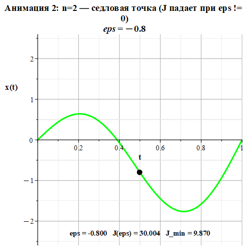
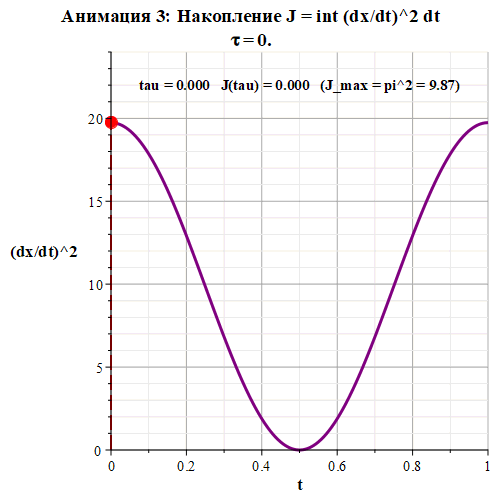
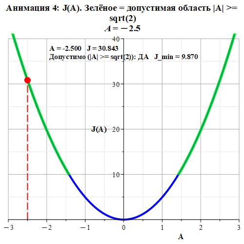
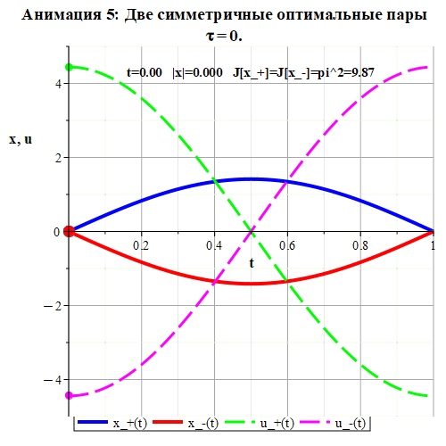
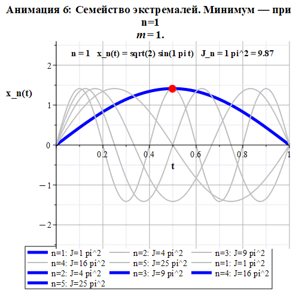

# Задача 9 (Часть 2) — Вариант 17

[](./Задача_9_Часть_2_Вариант_17.pdf)

## 1. Постановка задачи

Найти экстремум функционала:

$$
J[x] = \int_0^1 \dot{x}^2\,dt \to \text{extr},
$$

при ограничении:

$$
\int_0^1 x^2\,dt \ge 1, \qquad x(0) = x(1) = 0.
$$

## 📄 Документы

*   **[📥 Скачать PDF с подробным решением](./Projects/Задача_9_Часть_2_Вариант_17.pdf)**
*   **[📝 Исходный код LaTeX](./Codes/Задача_9_Часть_2_Вариант_17.tex)**
*   **[💻 Рабочий файл Maple (.mw)](./Codes/Задача_9_Часть_2_Вариант_17.mw)** *(откроется в программе)*
*   **[📄 Код Maple (.mpl) прямо на сайте](./Codes/Задача_9_вариант_17_часть_2.mpl)** *(текстовая версия)*

## 2. Аналитическое решение

### Обоснование активного ограничения

Ограничений на $\dot{x}$ нет.

Если предположить, что $A = \int_0^1 x^2\,dt > 1$, то функция
$y = x/\sqrt{A}$ допустима и лежит на границе
($\int_0^1 y^2\,dt = 1$), при этом $J[y] = J[x]/A < J[x]$.

Значит, минимум достигается строго на границе
$\int_0^1 x^2\,dt = 1$.

### Необходимые условия (KKT)

Лагранжиан:

$$
\mathcal{L} = \int_0^1 \left(\dot{x}^2 - \mu x^2\right) dt + \mu, \qquad \mu \ge 0.
$$

Уравнение Эйлера–Лагранжа:

$$
\ddot{x} + \mu x = 0, \qquad x(0) = x(1) = 0.
$$

### Решение краевой задачи

При $\mu = \omega^2 > 0$ решение имеет вид

$$
x(t) = B\sin(\omega t).
$$

Из условия $x(1) = 0$ получаем $\omega = \pi n$, где $n = 1, 2, \dots$

Из условия нормировки $\int_0^1 x^2\,dt = 1$ находим $B = \pm\sqrt{2}$.

**Ответ.** Две оптимальные пары (отличаются знаком):

$$
\hat{x}_\pm(t) = \pm \sqrt{2} \sin(\pi t), \quad \hat{u}_\pm(t) = \pm \sqrt{2} \pi \cos(\pi t).
$$

Соответствующие значения функционала:

$$
J_{\min} = \pi^2.
$$

Обе пары дают строгий глобальный минимум.

При $n \geq 2$ соответствующие функции являются седловыми точками.

---

## 3. 🎬 Визуализация (6 анимаций)

### Анимация 1. Оптимальная траектория и управление
**Файл:** `anim_optimal_trajectory.gif`


Точка движется по $\hat{x}\_+(t)$ (синяя линия) и $\hat{u}\_+(t)$ (красная линия).
Под обеими кривыми закрашивается пройденная площадь, отображаются текущие $t$, $x$, $u$.

---

### Анимация 2. Вариация седловой точки $n = 2$
**Файл:** `anim_saddle_variation.gif`



Траектория $x_\varepsilon(t) = \sqrt{2-\varepsilon^2}\sin(2\pi t) + \varepsilon\sin(\pi t)$
при любом $\varepsilon$ удовлетворяет ограничению $\int x_\varepsilon^2 = 1$.
Функционал $J(\varepsilon) = \pi^2(4 - 1.5\varepsilon^2)$ **падает** при $\varepsilon \ne 0$ ⇒
$x_2$ — **седловая точка**.

---

### Анимация 3. Накопление функционала $\int \dot{x}^2\,dt$
**Файл:** `anim_integrand_accumulation.gif`



Подграфик $\dot{x}^2(t) = 2\pi^2\cos^2(\pi t)$ заполняется; текущее значение
$J(\tau) = \int_0^\tau \dot{x}^2\,dt$ стремится к $\pi^2 \approx 9.87$.

---

### Анимация 4. Парабола $J(A)$ с допустимой областью
**Файл:** `anim_amplitude_parabola.gif`



Парабола $J(A) = \pi^2 A^2/2$; зелёным выделена **допустимая область** $|A| \ge \sqrt{2}$
(из ограничения $\int x^2 = A^2/2 \ge 1$). Красная точка скользит по кривой;
в подписи — проверка допустимости и значение $J_{\min} = \pi^2$ на границе.
Обосновывает **активность ограничения** (§2).

---

### Анимация 5. Две симметричные оптимальные пары
**Файл:** `anim_dual_optima.gif`



Четыре кривые в контрастных цветах с закраской пройденной площади:
$\hat{x}_+$ (синяя сплошная), $\hat{x}_-$ (красная сплошная),
$\hat{u}_+$ (зелёная штриховая), $\hat{u}_-$ (пурпурная штриховая).
Обе пары $(\hat{x}_\pm, \hat{u}_\pm)$ дают $J_{\min} = \pi^2$.

---

### Анимация 6. Семейство экстремалей $x_n(t) = \sqrt{2}\sin(n\pi t)$
**Файл:** `anim_extremal_family.gif`



Поочерёдно подсвечиваются кривые $n=1,\dots,5$ с подписями $J_n = n^2\pi^2$.
Видно: $J$ растёт как $n^2$; глобальный минимум — при $n=1$.
При $n \ge 2$ — седловые точки.

---

## 4. Maple-код для генерации анимаций

<details>
<summary>Нажмите, чтобы раскрыть полный Maple-код</summary>

```maple
restart;
with(plots):
with(plottools):

# ============================================================
# Общие определения
# ============================================================
x_opt := t -> sqrt(2)*sin(Pi*t);
u_opt := t -> sqrt(2)*Pi*cos(Pi*t);

TITLE_FONT := [TIMES, BOLD, 15]:
LABEL_FONT := [TIMES, BOLD, 13]:
TEXT_FONT  := [TIMES, BOLD, 12]:

# ============================================================
# 1. Оптимальная траектория и управление
# ============================================================
anim1 := proc(tau)
    local xc, uc, fillx, fillu, p1, p2, txt;
    xc    := plot(x_opt(t), t=0..1, color=blue, thickness=4,
                  legend="x(t)=sqrt(2) sin(pi t)");
    uc    := plot(u_opt(t), t=0..1, color=red, thickness=2,
                  linestyle=dash, legend="u(t)=sqrt(2) pi cos(pi t)");
    fillx := plot(x_opt(t), t=0..tau, color=blue, thickness=4,
                  filled=true, transparency=0.85);
    fillu := plot(u_opt(t), t=0..tau, color=red, thickness=2,
                  linestyle=dash, filled=true, transparency=0.9);
    p1    := point([tau, x_opt(tau)], color=blue, symbol=solidcircle, symbolsize=20);
    p2    := point([tau, u_opt(tau)], color=red,  symbol=solidcircle, symbolsize=20);
    txt   := textplot([0.5, 3.8,
        sprintf("t = %.3f   x = %.3f   u = %.3f", tau, x_opt(tau), u_opt(tau))],
        font=TEXT_FONT);
    display(xc, uc, fillx, fillu, p1, p2, txt,
            title="Анимация 1: Оптимальные траектория и управление",
            titlefont=TITLE_FONT, labels=["t","x, u"],
            labelfont=LABEL_FONT, view=[0..1, -4.5..4.5], gridlines=true);
end proc:

# ============================================================
# 2. Вариация седловой точки n=2
# ============================================================
x_pert := (t, eps) -> sqrt(2 - eps^2)*sin(2*Pi*t) + eps*sin(Pi*t);
J_pert := eps -> Pi^2*(4 - 1.5*eps^2);   # аналитически!

anim2 := proc(eps)
    local p, pt, txt;
    p   := plot(x_pert(t, eps), t=0..1, color=green, thickness=3,
                labels=["t","x(t)"], labelfont=LABEL_FONT);
    pt  := point([0.5, x_pert(0.5, eps)],
                 color=black, symbol=solidcircle, symbolsize=16);
    txt := textplot([0.5, -2.3,
        sprintf("eps = %.3f   J(eps) = %.3f   J_min = %.3f",
                eps, J_pert(eps), evalf(Pi^2))],
        font=TEXT_FONT);
    display(p, pt, txt,
            title="Анимация 2: n=2 — седловая точка (J падает при eps != 0)",
            titlefont=TITLE_FONT, view=[0..1, -2.6..2.6], gridlines=true);
end proc:

# ============================================================
# 3. Накопление интеграла от (dx/dt)^2
# ============================================================
anim3 := proc(tau)
    local integrand, fill, pt, vline, txt, val;
    val := Pi^2*tau;   # int_0^tau 2*pi^2*cos(pi*t)^2 dt = pi^2 * tau
    integrand := plot(2*Pi^2*cos(Pi*t)^2, t=0..1, color=purple, thickness=3,
                      labels=["t","(dx/dt)^2"], labelfont=LABEL_FONT);
    fill := plot(2*Pi^2*cos(Pi*t)^2, t=0..tau, color=purple, thickness=3,
                 filled=true, transparency=0.3);
    pt   := point([tau, 2*Pi^2*cos(Pi*tau)^2],
                  color=red, symbol=solidcircle, symbolsize=18);
    vline := plot([[tau,0],[tau,2*Pi^2*cos(Pi*tau)^2]],
                  color=red, linestyle=dash, thickness=2);
    txt  := textplot([0.5, 22,
        sprintf("tau = %.3f   J(tau) = %.3f   (J_max = pi^2 = %.2f)",
                tau, val, evalf(Pi^2))],
        font=TEXT_FONT);
    display(integrand, fill, pt, vline, txt,
            title="Анимация 3: Накопление J = int (dx/dt)^2 dt",
            titlefont=TITLE_FONT, view=[0..1, 0..24], gridlines=true);
end proc:

# ============================================================
# 4. Парабола J(A) с допустимой областью |A| >= sqrt(2)
# ============================================================
anim4 := proc(A)
    local parab, feas_p, feas_n, pt, vline, txt, ok, Amax;
    Amax := 3;
    parab  := plot(Pi^2*A0^2/2, A0=-Amax..Amax, color=blue, thickness=4,
                   labels=["A","J(A)"], labelfont=LABEL_FONT);
    feas_p := plot(Pi^2*A0^2/2, A0=sqrt(2)..Amax,
                   color=green, thickness=6, transparency=0.3);
    feas_n := plot(Pi^2*A0^2/2, A0=-Amax..-sqrt(2),
                   color=green, thickness=6, transparency=0.3);
    vline  := plot([[A,0],[A, Pi^2*A^2/2]],
                   color=red, linestyle=dash, thickness=2);
    pt     := point([A, Pi^2*A^2/2],
                    color=red, symbol=solidcircle, symbolsize=20);
    ok := `if`(evalf(abs(A)) >= evalf(sqrt(2)), "ДА", "НЕТ");
    txt := textplot([0, 37,
        sprintf("A = %.3f   J = %.3f\n"
                "Допустимо (|A| >= sqrt(2)): %s   J_min = %.3f",
                A, Pi^2*A^2/2, ok, evalf(Pi^2))],
        font=TEXT_FONT);
    display(parab, feas_p, feas_n, vline, pt, txt,
            title="Анимация 4: J(A). Зелёное = допустимая область |A| >= sqrt(2)",
            titlefont=TITLE_FONT, view=[-Amax..Amax, 0..40], gridlines=true);
end proc:

# ============================================================
# 5. Две равноправные оптимальные пары (с закраской)
# ============================================================
anim5 := proc(tau)
    local p1, p2, u1, u2,
          fx1, fx2, fu1, fu2,
          pp1, pp2, pu1, pu2, txt;
    # --- полные кривые ---
    p1 := plot( x_opt(t), t=0..1, color=blue,   thickness=4, legend="x_+(t)");
    p2 := plot(-x_opt(t), t=0..1, color=red,    thickness=4, legend="x_-(t)");
    u1 := plot( u_opt(t), t=0..1, color=green,   thickness=3,
                linestyle=dash, legend="u_+(t)");
    u2 := plot(-u_opt(t), t=0..1, color=magenta, thickness=3,
                linestyle=dash, legend="u_-(t)");
    # --- закраска пройденной части ---
    fx1 := plot( x_opt(t), t=0..tau, color=blue,    thickness=4,
                 filled=true, transparency=0.80);
    fx2 := plot(-x_opt(t), t=0..tau, color=red,     thickness=4,
                 filled=true, transparency=0.80);
    fu1 := plot( u_opt(t), t=0..tau, color=green,   thickness=3,
                 linestyle=dash, filled=true, transparency=0.85);
    fu2 := plot(-u_opt(t), t=0..tau, color=magenta, thickness=3,
                 linestyle=dash, filled=true, transparency=0.85);
    # --- маркеры-точки ---
    pp1 := point([tau,  x_opt(tau)], color=blue,    symbol=solidcircle, symbolsize=18);
    pp2 := point([tau, -x_opt(tau)], color=red,     symbol=solidcircle, symbolsize=18);
    pu1 := point([tau,  u_opt(tau)], color=green,   symbol=solidcircle, symbolsize=14);
    pu2 := point([tau, -u_opt(tau)], color=magenta, symbol=solidcircle, symbolsize=14);
    # --- подпись ---
    txt := textplot([0.5, 4.3,
        sprintf("t=%.2f   |x|=%.3f   J[x_+]=J[x_-]=pi^2=%.2f",
                tau, abs(x_opt(tau)), evalf(Pi^2))],
        font=TEXT_FONT);
    display(p1, p2, u1, u2,
            fx1, fx2, fu1, fu2,
            pp1, pp2, pu1, pu2, txt,
            title="Анимация 5: Две симметричные оптимальные пары",
            titlefont=TITLE_FONT, labels=["t","x, u"],
            labelfont=LABEL_FONT, view=[0..1, -5..5], gridlines=true);
end proc:

# ============================================================
# 6. Семейство экстремалей x_n = sqrt(2) sin(n pi t)
# ============================================================
anim6 := proc(nn)
    local curves, pt, txt, k, n;
    n := round(nn);
    curves := [seq(plot(sqrt(2)*sin(k*Pi*t), t=0..1,
                        color     = `if`(k=n, blue, gray),
                        thickness = `if`(k=n, 5, 2),
                        legend    = sprintf("n=%d: J=%d pi^2", k, k^2)), k=1..5)];
    pt  := point([0.5, sqrt(2)*sin(n*Pi*0.5)],
                 color=red, symbol=solidcircle, symbolsize=20);
    txt := textplot([0.5, 2.3,
        sprintf("n = %d   x_n(t) = sqrt(2) sin(%d pi t)   J_n = %d pi^2 = %.2f",
                n, n, n^2, evalf(n^2*Pi^2))],
        font=TEXT_FONT);
    display(op(curves), pt, txt,
            title="Анимация 6: Семейство экстремалей. Минимум — при n=1",
            titlefont=TITLE_FONT, labels=["t","x_n(t)"],
            labelfont=LABEL_FONT, view=[0..1, -2.6..2.6], gridlines=true);
end proc:

# ============================================================
# ЗАПУСК
# ============================================================
plots:-animate(anim1, [tau], tau=0..1,      frames=120, background=white);
plots:-animate(anim2, [eps], eps=-0.8..0.8, frames=120, background=white);
plots:-animate(anim3, [tau], tau=0..1,      frames=120, background=white);
plots:-animate(anim4, [A],   A=-2.5..2.5,   frames=120, background=white);
plots:-animate(anim5, [tau], tau=0..1,      frames=120, background=white);
plots:-animate(anim6, [m],   m=1..5,        frames=100, background=white);
```

</details>
| 4 | §2 | Активность ограничения: $J_{\min}$ на границе $\|A\|=\sqrt2$ |
| 5 | §11 | Неединственность: две симметричные оптимальные пары |
| 6 | §7–8 | Почему $n=1$: $J_n=n^2\pi^2$, минимум при $n=1$ |
