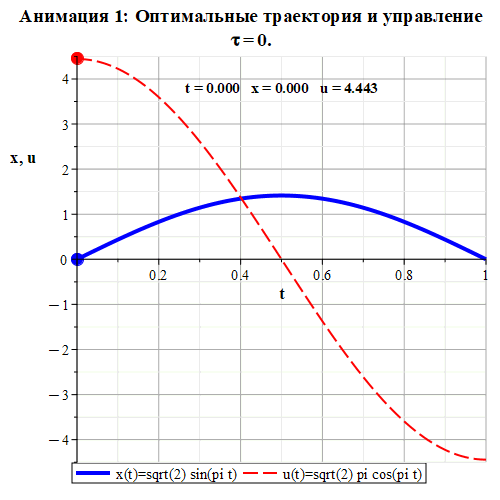

# Задача 9 (Часть 2) — Вариант 17

[](./Задача_9_Часть_2_Вариант_17.pdf)

## 1. Постановка задачи

Найти экстремум функционала:

$$J[x] = \int_0^1 \dot{x}^2 dt \to \text{extr},$$

при ограничении:

$$\int_0^1 x^2 dt \ge 1, \quad x(0) = x(1) = 0.$$

## 2. Аналитическое решение

### Обоснование активного ограничения

Ограничений на $\dot{x}$ нет.

Если предположить, что $A = \int_0^1 x^2\,dt > 1$, то функция
$y = x/\sqrt{A}$ допустима и лежит на границе
($\int_0^1 y^2\,dt = 1$), при этом $J[y] = J[x]/A < J[x]$.

Значит, минимум достигается строго на границе
$\int_0^1 x^2\,dt = 1$.

### Необходимые условия (KKT)

Лагранжиан:

$$
\mathcal{L} = \int_0^1 \left(\dot{x}^2 - \mu x^2\right) dt + \mu, \qquad \mu \ge 0.
$$

Уравнение Эйлера–Лагранжа:

$$
\ddot{x} + \mu x = 0, \qquad x(0) = x(1) = 0.
$$

### Решение краевой задачи

При $\mu = \omega^2 > 0$ решение имеет вид

$$
x(t) = B\sin(\omega t).
$$

Из условия $x(1) = 0$ получаем $\omega = \pi n$, где $n = 1, 2, \dots$

Из условия нормировки $\int_0^1 x^2\,dt = 1$ находим $B = \pm\sqrt{2}$.

**Ответ.**

Две оптимальные пары

Рассмотрим две оптимальные пары, которые отличаются знаком:

$$
\hat{x}_\pm(t) = \pm \sqrt{2} \sin(\pi t), \quad \hat{u}_\pm(t) = \pm \sqrt{2} \pi \cos(\pi t).
$$

Соответствующие значения функционала:

$$
J_{\min} = \pi^2.
$$

Обе пары дают строгий глобальный минимум. 

При $n \geq 2$ соответствующие функции являются седловыми точками.

---

## 3. Визуализация

### Анимация 1. Оптимальная траектория и управление

**Файл:** `anim_optimal_trajectory.gif`



*Точка движется по* $\hat{x}_+(t)$ *(синяя линия) и* $\hat{u}_+(t)$ *(красная линия).*

### Анимация 2. Вариация седловой точки ($n = 2$)

**Файл:** `anim_saddle_variation.gif`


*При изменении* $\varepsilon$ *функционал* $J$ *сначала падает, затем растёт:* $\varepsilon = 0$ *— седловая точка.*

### Анимация 3. Поверхность функционала $J(\varepsilon)$

**Файл:** `anim_functional_surface.gif`


*3D-визуализация окрестности седловой точки* $n = 2$.

---

## 4. Maple-код для генерации анимаций

<details>
<summary>Нажмите, чтобы раскрыть Maple-код</summary>

```maple
restart;
with(plots):
with(plottools):

# ==========================================
# 1. Оптимальная траектория и управление
# ==========================================
x_opt := t -> sqrt(2)*sin(Pi*t);
u_opt := t -> sqrt(2)*Pi*cos(Pi*t);

anim1 := proc(tau)
    local p1, p2, pt1, pt2;
    if tau = 0 then
        return display(
            plot(x_opt(t), t=0..1, color=blue, thickness=3, labels=["t","x, u"]),
            plot(u_opt(t), t=0..1, color=red, thickness=2, linestyle=dash),
            title="Оптимальная траектория и управление", view=[0..1, -4.5..4.5]
        );
    end if;
    pt1 := point([tau, x_opt(tau)], color=blue, symbol=solidcircle, symbolsize=15);
    pt2 := point([tau, u_opt(tau)], color=red, symbol=solidcircle, symbolsize=15);
    display(
        plot(x_opt(t), t=0..1, color=blue, thickness=3),
        plot(u_opt(t), t=0..1, color=red, thickness=2, linestyle=dash),
        pt1, pt2,
        title=sprintf("t = %.2f", tau), view=[0..1, -4.5..4.5]
    );
end proc:

# Для экспорта: plots:-animate(anim1, [tau], tau=0..1, frames=60, background=white);

# ==========================================
# 2. Вариация седловой точки (n=2)
# ==========================================
x_pert := (t, eps) -> sqrt(2 - eps^2)*sin(2*Pi*t) + eps*sin(Pi*t);
J_pert := (eps) -> int(diff(x_pert(t, eps), t)^2, t=0..1);

anim2 := proc(eps)
    local p, pt, val;
    val := evalf(J_pert(eps));
    p := plot(x_pert(t, eps), t=0..1, color=green, thickness=3,
              title=sprintf("Вариация n=2: eps = %.2f, J = %.2f", eps, val),
              view=[0..1, -2..2]);
    pt := point([0.5, x_pert(0.5, eps)], color=black, symbol=solidcircle, symbolsize=12);
    return display(p, pt);
end proc:

# Для экспорта: plots:-animate(anim2, [eps], eps=-0.8..0.8, frames=60, background=white);

# ==========================================
# 3. 3D-поверхность J(eps)
# ==========================================
plot3d(
    J_pert(eps), eps=-0.9..0.9, theta=0..1,
    axes=boxed, labels=["eps", "theta", "J"],
    title="Функционал J(eps) в окрестности n=2",
    style=surface, color=J_pert(eps)
);
# Для экспорта анимации 3D можно использовать plots:-animate с параметром theta.
